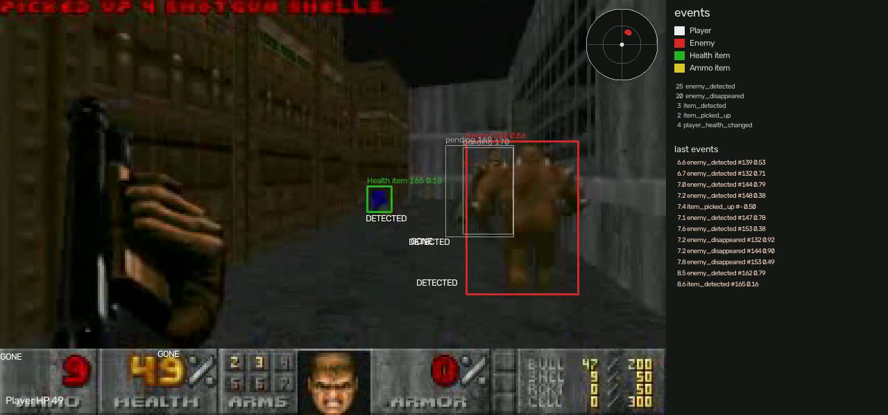
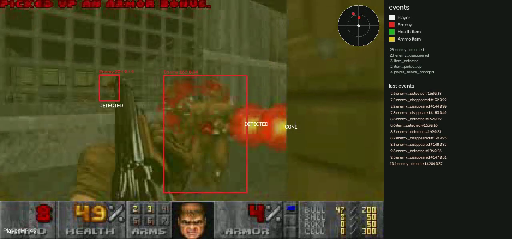
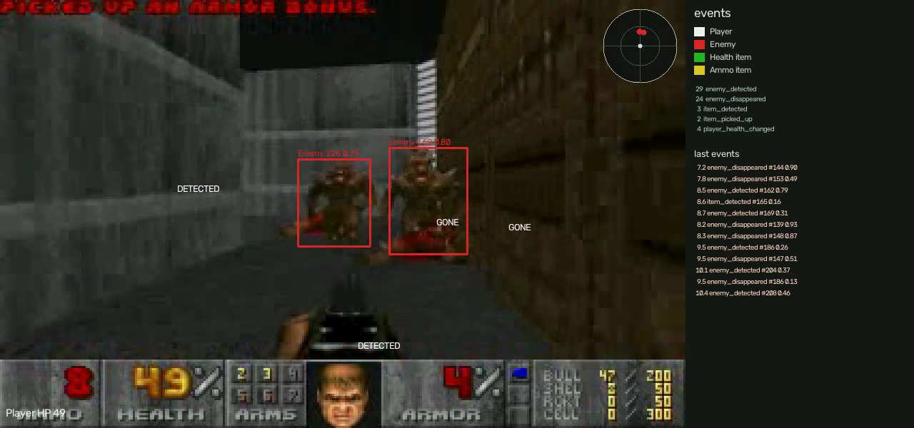

# Doom gameplay event detection

A Python pipeline that watches a public Doom II speedrun and writes structured gameplay events: an enemy appearing or leaving, an item appearing or being picked up, and the player's health changing. Each event has a timestamp and a confidence. Enemy events also carry a relative bearing and a near/mid/far proximity, drawn as a small radar on the annotated video.

## Approach

The frame is split into two regions. At the vanilla 320x200 resolution, rows 0–167 are the gameplay view and rows 168–199 are the status bar. Other resolutions are resized to 320x200 first.

Two branches run on every frame and are merged at the end:

1. **View.** A fine-tuned YOLO11n detector finds enemies, health items, and ammo items. ByteTrack gives each box an id. A short state machine turns those tracks into events.
2. **Status bar.** Fixed digit cells are read with OpenCV template matching. A value is kept only after it repeats for three frames. A health change becomes a HUD event. An ammo change is not an event; it only helps confirm a pickup.

```
gameplay view  ->  YOLO11n  ->  ByteTrack  ->  event rules  --+
                                                               +-->  events.json / events.csv
status bar     ->  template OCR  ->  3-frame filter  ->  HUD  --+     annotated.mp4 + radar
```

### Classes

CocoDoom labels sprites with Chocolate Doom's object names. Those names are mapped to three classes:

| Class | Examples |
| --- | --- |
| `enemy` | imp, demon, baron, cacodemon, lost soul, and the other Doom II monsters |
| `health_item` | stimpack, medikit, health bonus, soulsphere, megasphere |
| `ammo_item` | clips, shells, rockets, cells, and their boxes |

CocoDoom keeps the monster's name on a corpse. Corpse sprites are wide and flat, so any enemy box with height/width below 0.6 is left out of training. A kill then shows up as the track disappearing rather than as a second class. Wide live monsters (a spider mastermind seen from the front, a mancubus side-on) can be dropped by the same rule. That is a known limit of the filter.

Projectiles, barrels, armor, weapons on the ground, and the player's gun sprite are not classes.

The video reports four object types: Player, Enemy, Health item, and Ammo item. The player is the first-person camera, so there is no player sprite to detect, and CocoDoom has no player class. The player is shown through the status bar health instead.

### How an event is derived

A track is **confirmed** once it is seen in 3 of the last 5 frames. Its class is the majority vote of its detections, and its confidence is the mean detector score over those frames. The event time is the first frame of the track, not the frame that crossed the threshold.

| Event | When it fires |
| --- | --- |
| `enemy_detected` | An enemy track is confirmed. |
| `enemy_disappeared` | A confirmed enemy track has not been seen for 0.5 s. The time is the last frame it was seen. |
| `item_detected` | A health or ammo item track is confirmed. An item that leaves the view without a pickup adds no further event. |
| `item_picked_up` | An item track ends in the bottom-centre of the view (where the player walks into it), or the matching counter goes up within 1 s after the item was last seen. One increase is paired with one item. An item that only slides off the side of the screen does not count. |
| `player_health_changed` | The filtered health reading changes. `old_value`, `new_value`, and `delta` are stored. |

These five are the only events written. A single-frame detection, or a one-frame misread of a digit, does not emit an event.

The player's gun is not a world object. A box that sits on the bottom edge, is centred, and is at least 60 pixels wide is dropped before tracking.

### Status bar

Health and ammo use the vanilla three-digit cells: ammo occupies x = 2–44 and health x = 48–90, both at y = 171–187, each digit 14×16 and right-aligned. Each cell is turned into an ink mask (gold, green, or red on the gray stone) and matched with `cv2.matchTemplate` against digit templates cropped from a clip. Several digits have a second crop, because the same glyph is redrawn in a different palette and one template is not enough (a green zero was being read as an eight, a gold two as an eight).

A new reading is accepted only after the same number appears on three consecutive frames. Confidence is the weakest digit's match score.

### Relative radar

Bearing is `atan((x_center - 160) / 160)` in degrees. Ahead is 0 and right is positive, which matches Doom's 90-degree horizontal field of view. Proximity is the box height: near at 40 pixels or more, mid at 18 or more, otherwise far. The radar is an inset on the annotated video, and the same bearing and proximity are attached to enemy events. This is a direction and a rough distance, not a map position.

## Model and tools

- **Detector:** Ultralytics YOLO11n, fine-tuned from the COCO checkpoint. Image size 320, 12 epochs, batch 16, on Apple MPS. CocoDoom's training frames are sampled every few tics and are near-duplicates, and a full pass is about 18 minutes per epoch on an M2, so training uses a random 15% of the training images. The held-out test maps are not subsampled.
- **Tracker:** Ultralytics ByteTrack (`bytetrack.yaml`). BoT-SORT was tried on the first eight seconds of MAP04. Median track length moved from 3 frames to 5, which still does not hold an identity through a turn, so the pipeline stays on ByteTrack.
- **OCR:** OpenCV template matching. No Tesseract.
- **Everything else:** NumPy, pandas, pytest.

## Data

All of it is public. Nothing here was rendered for this project.

- **[CocoDoom v1.0.1 standard archive](https://www.robots.ox.ac.uk/~vgg/share/cocodoom-v1.0.1.tar.gz)** (Oxford VGG, about 2.3 GB). Doom II frames from human speedrun demos with COCO boxes. These frames have no status bar, so they train and score the detector only. The published map split is `(map_id - 1) % 4`: 0 and 1 train, 2 validation, 3 test. Test maps include MAP04, MAP08, MAP12, MAP16, MAP20, MAP24, MAP28, and MAP32.
- **[Doom2_UVlevels](https://archive.org/details/Doom2_UVlevels)** on the Internet Archive. Compet-N UV speedruns at 320×200, 35 tic recordings stored at 30 fps, with the classic status bar. The clips are held-out maps:
  - `Doom2_UV_lv04_028.avi` (MAP04, The Focus)
  - `Doom2_UV_lv08_022.avi` (MAP08, Tricks and Traps), used only to tune the pipeline
  - `Doom2_UV_lv12_043.avi` (MAP12, The Factory)
  - `Doom2_UV_lv20_034.avi` (MAP20, Gotcha!)

### How enemies and items are labeled

`annotations/<clip>_objects.csv` lists each time an object is on screen. One shared rule turns those rows into events, so the labels and the pipeline mean the same thing.

- An enemy is a live monster whose sprite is at least 8 px tall at 320×200. A sprite cut off by the screen edge still counts. A dying monster counts until it lies flat.
- An item is a health or ammo pickup whose longer side is at least 8 px. Weapons, armor, keys, and powerups are not items.
- The intermission screen is ignored.
- Each row is `object,class_name,first_frame,last_frame,picked_up`. The same object id can appear again after it leaves and comes back. `picked_up` is 1 when the player walks over that item.
- Intervals of one object less than 0.5 s apart are one presence. A presence of at least 3 frames gives `enemy_detected` or `item_detected` at its first frame. An enemy presence gives `enemy_disappeared` at its last frame, unless it is still on screen in the last 0.5 s of the clip. An item presence gives `item_picked_up` at its last frame when it was picked up, and nothing otherwise.
- The contact sheets step every 10 frames. A row that was only one sample was widened by 5 frames on either side so the interval covers the gap between samples. A pickup keeps the frame it was taken and only the start moves earlier.

`scripts/label_frames.py` writes contact sheets and boundary crops of the raw view. Those images have no detector boxes. A white 8 px bar in the corner is the size cutoff.

## Results

Detection scores are precision, recall, and F1 at IoU 0.5 on the CocoDoom test maps (5,804 images, maps the detector never trained on), plus Ultralytics mAP50. Event scores match each hand-labeled event to one prediction of the same type within ±0.5 s. OCR scores compare health and ammo read off the status bar once a second, for the raw digit match and for the 3-frame filter.

`scripts/evaluate.py` writes `outputs/metrics.json`. Each clip also has `outputs/<clip>/events.json`, `events.csv`, `annotated.mp4`, and a few screenshots.

### Detection

The shipped weights are a second fine-tune of the first Doom model: 20 epochs at image size 416, on the same 15% CocoDoom training sample, about two hours on an M2. Test mAP50 is 0.549 and mAP50-95 is 0.360 (previously 0.461 and 0.284 at image size 320).

| Class | Precision | Recall | F1 |
| --- | ---: | ---: | ---: |
| enemy | 0.747 | 0.546 | 0.631 |
| health_item | 0.705 | 0.517 | 0.597 |
| ammo_item | 0.738 | 0.390 | 0.511 |

These precision and recall figures are Ultralytics' test scores, taken at the confidence that maximises F1. The video pipeline feeds the tracker detections down to confidence 0.1. A new track still has to clear 0.25. mAP50 averages across confidence thresholds.

### Events

Ground truth is built from the visibility intervals with the same 3-of-5 and 0.5 s constants the pipeline uses. MAP08 (`Doom2_UV_lv08_022`) is the only clip used to choose settings. The three report clips were scored once, after those settings were frozen. One frozen round was run. A lower ByteTrack new-track threshold was tried on MAP08 and dropped, because it added false pickups and did not raise view F1.

Only the five emitted event types are scored. `item_disappeared` and `player_ammo_changed` were dropped from the output, and from the ground truth with them. Health changes on the report clips match the hand labels: `player_health_changed` F1 is 1.00. MAP08 has no HUD labels.

The view row is enemies and items only. It is the number this round was aiming at (0.8 on each report clip). None of the three reached it.

| Clip | Role | View P | View R | View F1 |
| --- | --- | ---: | ---: | ---: |
| MAP08 | dev | 0.439 | 0.486 | 0.462 |
| MAP04 | report | 0.504 | 0.882 | 0.642 |
| MAP12 | report | 0.513 | 0.894 | 0.652 |
| MAP20 | report | 0.367 | 0.659 | 0.472 |

MAP04 is the closest. Its misses are extra pickups (item pickup F1 0.29, five false alarms) and enemy tracks that still fragment. MAP12 misses the one labeled ammo pickup. MAP20 is the weak clip: the detector emits health and ammo sprites the labels do not contain, and several labeled enemies never become a track. Those labels were not edited after this run.

On MAP04, `enemy_detected` F1 is 0.60 and `enemy_disappeared` is 0.68. `item_detected` is 0.77. A pickup is a yellow flash in the view together with a health or ammo increase, or a flash together with an item that vanished in the bottom centre. A weapon switch that only raises the ammo number does not count. An armor bonus does not count. Two monsters of the same class that trade places within 0.5 s can be merged into one track.

### OCR

| Clip | Raw accuracy | Filtered accuracy | Labeled values |
| --- | ---: | ---: | ---: |
| MAP04 | 1.000 | 0.931 | 58 |
| MAP12 | 1.000 | 0.973 | 75 |
| MAP20 | 0.986 | 0.903 | 72 |

The filter is a little less accurate on these once-a-second samples because it waits two extra frames before accepting a new number, so a sample that lands on the change still shows the previous value. That same wait is what keeps a one-frame misread from becoming an event. The digit templates, including the alternate crops, were cut from these same three clips, so the OCR numbers are in-sample.

Hand labels:

- `annotations/*_hud.csv` — health and ammo read off the status bar at each whole second. Blank ammo means the fist is selected and the counter is empty. Intermission screens are omitted.
- `annotations/*_hud_events.csv` — HUD changes only. The ammo rows are kept but not scored, because ammo changes are no longer events. A HUD change is timestamped at the first frame where the raw template read holds the new value for three frames. Those values were checked against the once-a-second visual reads in `*_hud.csv`. The event time is therefore close to the filter's own accept time (about two frames earlier), so the HUD event F1 mostly checks that the filter emits the same transitions the raw reader stabilized on, at the right moment.
- `annotations/*_objects.csv` — enemy and item visibility intervals. Events are derived from these, not stored as a second hand-written list.

## Failure cases

- **Damage flash.** A red pain flash repaints the status bar and the ink mask misses the digits. The filter holds the previous value, so a one-frame flash does not emit a change, but a flash that lasts through the sample frame is a raw-OCR miss.
- **Fist selected.** The ammo cell is blank. The filter keeps the last number and can lag behind a later weapon switch, which can delay pairing an ammo pickup with its increase.
- **Palette twins.** A few glyphs (2/8, 3/9, 5/6) stay close even with a second template. A misread that lasts three frames becomes a false HUD event.
- **Corpse filter.** Flat enemy boxes are not trained, so a live monster seen edge-on can be missed, and a death is only a disappearance. There is no `enemy_killed` event.
- **Gun and muzzle flash.** The gun filter drops a wide box on the bottom edge. A monster standing in that same spot, or a flash that covers it, can be dropped or can split the track.
- **Fast turns.** A new track of the same class can inherit an unseen parent if the gap is under 0.5 s and the sprite height stays within a factor of two. Two monsters of the same class that swap places inside that window become one track.
- **Crowds.** Several monsters in one room often produce fewer confirmed tracks than labeled sprites, especially when they are small or partly overlapping. That is the main miss on MAP08 and part of the miss on MAP20.
- **Pickups.** There is no pickup without the yellow view flash. A flash that lines up with a counter increase, or with an item that just left the bottom centre, still becomes a pickup, so a few false pickups remain on MAP04 and MAP20. A sprite under 8 px never starts an event.
- **Intermission.** Frames whose status bar does not match the HEALTH label are ignored, so the tally screen does not add enemies or items.
- **Radar.** Bearing assumes a 90-degree view and a centred player. Proximity is sprite height, so a lost soul and a baron at the same distance are not the same band.

## Demo

[outputs/Doom2_UV_lv04_028/demo.mp4](outputs/Doom2_UV_lv04_028/demo.mp4) is MAP04 with the frozen pipeline. It is H.264, 1280×600, 30 fps, 932 frames (31 s). The left side is the view. The right side lists the colours for Player, Enemy, Health item, and Ammo item, running counts, and the last 12 events. The player's health is printed at the bottom left of the view.

What to watch:

- **8.7 s.** Enemy 169 is confirmed. The box sits on the demon, the label shows the class, the id, and the confidence, and a DETECTED tag is on the sprite. A health item beside it has its own box.
- **10.2 s.** The player has turned, and the view is tinted yellow by a pickup flash. Id 169 is still open: `events.json` has no `enemy_disappeared` for it until 10.8 s.
- **10.9 s.** Id 169 leaves. A GONE tag sits on its last box, and `events.json` has `enemy_disappeared` for id 169 at 10.8 s.







Tracks that have not yet been seen in 3 of 5 frames are drawn thin and gray, labeled pending. Confirmed boxes use the class colour. A stitched fragment keeps its parent's number.

## Reproduce

```bash
# Python 3.12
uv venv --python 3.12 .venv
uv pip install -e ".[dev]"

bash scripts/fetch_data.sh          # CocoDoom (~2.3 GB) and the three clips
python scripts/build_dataset.py     # YOLO labels under data/yolo
python scripts/train.py             # first fine-tune, image size 320, writes models/yolo11n-doom.pt
python scripts/train.py --epochs 20 --imgsz 416 --patience 20 --model models/yolo11n-doom.pt
python -m gameplay_events.pipeline data/clips/Doom2_UV_lv04_028.avi
python scripts/evaluate.py
pytest

ffmpeg -y -i outputs/Doom2_UV_lv04_028/annotated.mp4 \
  -c:v libx264 -pix_fmt yuv420p -crf 20 -movflags +faststart \
  outputs/Doom2_UV_lv04_028/demo.mp4
```

`gameplay-events VIDEO --output outputs/NAME` is the same entry point. `--no-hud` skips the status bar, for a full-screen view with no counters.
